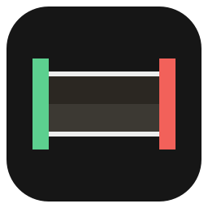

<div align="center">



# ClipTrimmer

**Cut the best moment out of a game replay and shrink it to fit Discord.**


</div>

A native Windows app built around OBS replay-buffer clips. Pick a clip, mark the parts you want, choose a
file size, export. Version 2.0 is a Qt + mpv rewrite of the original browser-based version (still in the
history).

## Features

- **Clip library**: every replay as a card, grouped by day, with a **Trimmed** tag once exported
- **Cover thumbnails**: each clip gets the frame just before you hit save, also used by File Explorer
- **Frame-accurate trimming**: In/Out flags on a frame strip, several sections joined in order
- **Export to a size**: 10 MB (Discord), 50 MB (Nitro), 512 MB (X) or custom, using two-pass x264
- **Hardware playback**: mpv drawn with Direct3D 11, low CPU even on 1080p120 HEVC
- **One-click share**: **Copy file** puts the export on the clipboard, ready to paste into Discord

## Install

1. Download or clone this repo
2. Build it (see [Development](#development)), then run `dist\ClipTrimmer\ClipTrimmer.exe`

## Usage

1. Open ClipTrimmer: it lists your replays (`Videos\OBS` by default)
2. Click a clip, then press **I** and **O** to mark a section (add more with **N**)
3. Pick a target size and press **Ctrl+E** to export
4. Press **Ctrl+Shift+C** to copy the file, then paste it into Discord

<details>
<summary><b>All keyboard shortcuts</b></summary>

| Keys | Action |
|---|---|
| Ctrl+B / Esc | All clips / back to the clip |
| Ctrl+L | Open the newest replay |
| I / O / N | Set In / Set Out / new section at the playhead |
| Space or K, P | Play/pause, play the selected section |
| ← → (or , .) | One frame back/forward; Shift+← → or J/L = 1 second |
| M, ↑ ↓ | Mute, volume up/down |
| Delete, Ctrl+Z / Ctrl+Y | Delete section, undo/redo |
| Ctrl+E, Ctrl+Shift+C | Export, copy the exported file |
| F1 | All shortcuts |

</details>

<details>
<summary><b>Command line</b></summary>

```
ClipTrimmer.exe [clip.mp4]          open a clip
ClipTrimmer.exe --covers [clip …]   add cover pictures without opening a window
```

`--covers` with no file does the whole replays folder. With a file, it waits for the file to finish being
written first. [PadDeck](https://github.com/lefewix/PadDeck) runs it right after it saves an OBS replay.
Only one ClipTrimmer runs at a time; starting it again brings the open window to the front.

</details>

## How it works

Playback is libmpv rendering into a native Direct3D 11 window inside the Qt UI. Exports go through ffmpeg:
sections are cut, joined and encoded in two passes, with the bitrate worked out from the target size and
the total length.

<details>
<summary><b>How covers stay safe</b></summary>

Adding a cover rewrites the mp4, so it's careful:

- It's a **lossless remux** (`ffmpeg -c copy`): video and audio packets are untouched, and audio track
  names (OBS's "Game audio", "Mic"…) are carried over.
- It writes to a temp file next to the clip, which is **checked** (same length, same streams plus the
  picture, not smaller) before it replaces the original. Created/modified dates are kept.
- A lock file stops two programs working on the same clip. Files changed in the last 10 seconds (OBS may
  still be writing) and the clip open in the player are skipped. Temp files left by a crash are cleaned up
  after 10 minutes.
- Only `.mp4` / `.m4v` get covers; other formats just get a card picture.

</details>

<details>
<summary><b>Project layout</b></summary>

```
ClipTrimmer.pyw      entry point (sets up PATH for bin\)
clipt\app.py         main window, navigation, single instance, --covers
clipt\browser.py     the clip list (cards, cover loader, folder watcher)
clipt\library.py     listing, day grouping, cover remux
clipt\rail.py        right panel: sections, size, bitrate card, export states
clipt\strip.py       frame strip with In/Out flags
clipt\engine.py      ffmpeg export (cut, join, two-pass to size)
clipt\model.py       sections + undo
clipt\player.py      mpv playback via Direct3D 11
clipt\theme.py       colours, fonts, icons, style sheet
```

</details>

## Development

Needs Python 3.12, plus ffmpeg and mpv in `bin\` (not in git, too big):

| File | Source |
|---|---|
| `ffmpeg.exe`, `ffprobe.exe` | [BtbN FFmpeg builds](https://github.com/BtbN/FFmpeg-Builds/releases), win64 **gpl** |
| `libmpv-2.dll` | [shinchiro mpv builds](https://github.com/shinchiro/mpv-winbuild-cmake/releases), `mpv-dev-x86_64` |

```powershell
py -3.12 -m venv .venv
.venv\Scripts\python.exe -m pip install -r requirements.txt
powershell -ExecutionPolicy Bypass -File build.ps1      # → dist\ClipTrimmer\ClipTrimmer.exe
```

Tests make their own synthetic clips and never touch your replays:

```powershell
.venv\Scripts\python.exe tests\test_engine.py  <workdir>        # export engine (36)
.venv\Scripts\python.exe tests\test_library.py <workdir>        # clip list, covers, locks (29)
.venv\Scripts\python.exe tests\ui_smoke.py <workdir> <shots>    # drives the real window (58)
```

## License

[MIT](LICENSE) © Felix Wang. Bundled fonts (Instrument Sans, JetBrains Mono) are under the SIL Open Font License.
